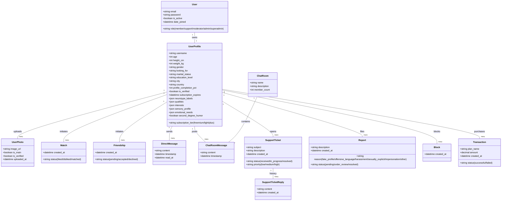

# Constela (Atypical Connection) - Complete Project Flow & Feature Specifications

This document outlines the complete application flow, system architecture, database models, and REST API endpoints for **Constela** (also referred to as **Atypical Connection**). It is designed to serve as a comprehensive blueprint for building the Django backend API.

---

## 1. System Overview

Constela is a specialized dating, friendship, and community application designed for neurodivergent individuals (e.g., Autistic, ADHD, AuDHD, Dyslexic, HSP, HPI, etc.). The platform reduces low-pressure interactions by matching individuals based on **neurotypes, sensory preferences, emotional needs, qualities, and common interests**, rather than just appearance.

The platform includes two main components:
1. **The Client Mobile Web/App**: Used by members to onboard, search for matches, add friends, join themed chat rooms, send direct messages, and manage their subscription.
2. **The Admin & Support Dashboard**: Used by support agents, moderators, and super-admins to handle reports, perform manual photo verification, resolve tickets, detect fake profiles, and manage system logs.

---

## 2. Core Flows & App Features

### 2.1. Authentication & Onboarding Flow
The registration process captures extensive profile details to enable compatible matching.

1. **Sign Up & Basic Auth**:
   - Email/password or OAuth (Google, Apple).
   - Email verification via OTP (4-digit code sent to user's email).
2. **Step 1: About You**:
   - Upload at least 1 photo (3 required for verification).
   - Set Username, Age, Height (cm), Gender (Woman, Man, Non-binary, Other).
3. **Step 2: Optional Information**:
   - Weight (kg), Education, Marital Status (Single, Widowed, Divorced, Separated), Spoken Languages, City, Country.
4. **Step 3: The Basics (Relationship Intent)**:
   - "Looking For": Friendship, Serious Relationship, We'll See, Going Out.
   - Do you have children? (Yes, No).
   - Do you want children? (Yes, No).
5. **Step 4: Lifestyle Habits**:
   - Smoking (Yes, No), Alcohol (Yes, No), Pets (Yes, No).
   - Sport (Intense, Moderate, No Sport).
   - Eating Habits (Balanced, Fast Food, Vegetarian, Vegan, Other).
6. **Step 5: Personal Qualities**:
   - User must choose **exactly 3 qualities** from a predefined list (e.g., Authenticity, Loyalty, Reliability, Emotional Sensitivity, Kindness, Honesty, Respect for Boundaries, Hyperfocus, Creativity, Deep Thinking, Attention to Detail, Strong Memory, etc.).
7. **Step 6: Interests & Sparking Curiosity**:
   - Select multiple interests grouped in categories:
     - *Logical & Structured*: Coding, Math, Patterns.
     - *Visual/Sensory*: Photography, Design, Colors.
     - *Animals & Nature*: Biology, Pets, Botany.
     - *Imaginary Universes*: Sci-Fi, D&D, Lore.
     - *Collecting*: History, Antiques, Cataloging.
     - *Language*: Linguistics, Writing, Etymology.
     - *Body & Movement*: Yoga, Dance, Proprioception.
     - *Mechanical*: Engines, Electronics, Systems.
     - *Psychology*: Behavior, Neurodiversity, Sociology.
8. **Step 7: Neurotype Identity**:
   - Select neurotype labels (Autistic, ADHD, AuDHD, Dyslexic, Questioning).
   - Toggles: "I'm Neurodivergent", "I'm open to meet neurodivergent individuals".
9. **Step 8: Emotional Landscape & Sensory Profile**:
   - *How I Recharge*: Silence, Cocoon Spaces, Reduced Stimulation.
   - *What Exhausts Me*: Absorbs other people's moods, Feels everything deeply, Loud/unpredictable noises, Bright lights, Fast movements, Strong smells, Unpleasant textures.
   - *My Emotional Needs*: Predictability, Consistency, Absence of judgment, Clear communication, Deep talk, Need for solitude.
   - *Second-Degree Humor*: Yes, No.
   - *What Soothes Me*: Silence/soft sounds, Dim light, Massage, Sensory objects, Chosen solitude, Comforting routines, Predictability, Clear Communication, Hyperfocus.

---

### 2.2. Core App Sections

#### A. Meet (Dating) Dashboard
- **Perfect Match Analysis**: Shows highly compatible profiles based on a matching algorithm (matching neurotypes, sensory profile, and qualities).
- **Match Carousel**: Swipe left (dislike) or right (like) on cards.
- **Sensory Filters**: Allows premium users to filter matches specifically by sensory profile, lifestyle habits, and emotional need variables.

#### B. Friends Dashboard
- **Search**: Find users by username or interest.
- **Friend Requests Queue**: Separate list showing pending friend requests with option to "Accept" or "Decline". Shows mutual friend count.
- **Add Friend Recommendations**: A list of recommended users to connect with platonically (displays common qualities and interests).

#### C. Community Chat Rooms
- Forums or groups built around interests/topics (e.g., "ADHD Hub", "Sanctuary", "HPI Thinkers", "HSP Calm").
- Real-time chat messages inside rooms, with members list, and the ability to join or leave the room.

#### D. One-on-One Messaging
- Direct message thread between matched dating users or accepted friends.
- Messages list and text entry.

#### E. Safety, Blocking, and User Reporting
- **Photo Verification**: Face detection and posture alignment checks. Users upload a live selfie to compare with profile photos for verification status.
- **Blocking**: Blocked users cannot view profiles, search for, or message the blocker.
- **User Reporting**: If a user reports another user, they **must** select a reason:
  - `fake_profile` (Fake or suspicious profile)
  - `offensive_language` (Offensive language)
  - `harassment` (Harassment or bullying)
  - `sexually_explicit_content` (Sexually explicit content)
  - `impersonation` (Impersonation)
  - `other` (Other violations)
  - *Optional detailed description.*

#### F. Settings & Account Management
- Change Email (requires OTP confirmation sent to the new email address).
- Change Password (requires current password and new password confirmation).
- Select Language (English, French, System default).
- Privacy & Blocked Users list (view and unblock).
- Push Notifications Toggles (Likes, New Messages).
- Payment History (transaction list containing Date, Plan Name, Amount, and Status).
- Account Deactivation toggle.
- Dark Mode toggle.

---

## 3. Subscription Tiers & Restrictions

| Feature | Freemium (Free) | Premium Light | Premium Plus |
| :--- | :--- | :--- | :--- |
| **Likes per Day** | 20 Likes | 50 Likes | Unlimited Likes |
| **New Messages** | 1 message/month | 3 messages/month | Unlimited Messages |
| **Chat Room Access**| None | Access to 5 themed rooms | Access to ALL themed rooms |
| **Search Filters** | Basic filters only | Advanced search filters | Full Advanced Filter toolkit |
| **Received Likes** | Hidden | See who liked you | See who liked you |
| **Ads** | Banner + Video ads | Banner ads still displayed | Banner ads displayed (Bottom) |
| **Pricing Tiers** | $0.00 | $4.99/mo, $12.99/3mo, $39.99/yr, $99.99/lifetime | Custom annual plan |

---

## 4. Admin & Support Dashboards

The backend must support an admin panel accessed by accounts with roles: `Moderator`, `Support`, `Admin`, or `Super Admin`.
1. **Admin Authentication**: Email (`admin@hoodlink.au` or custom) + Password + 6-digit OTP verification.
2. **Support Dashboard (Tickets Queue)**:
   - Queue of customer support tickets with details (Ticket ID, Priority: High/Medium/Low, Status: Received/In Progress/Resolved, Message list).
   - "Send Reply" action which emails the user directly.
   - "Mark as Resolved" action.
   - User profile preview popup displaying location, subscription, verification status, and profile completeness.
3. **Moderator Dashboard (Reports Queue)**:
   - Queue of user reports showing the reported user, reporter, priority, reason, and time elapsed.
   - Actions: "Review", "Ban", "Suspend" user.
   - Lists of Suspended Users, Banned Users, and Fake Profile Detection reports.
4. **Photo Verification Queue**:
   - Moderation interface to manually review user selfies and verify profiles.
   - Log of all admin actions (Admin Action History).

---

## 5. Proposed Database Models (Django)

Here is the database architecture to support the features above.



### Django Model Definitions (Reference)

```python
from django.db import models
from django.contrib.auth.models import AbstractUser

class User(AbstractUser):
    ROLE_CHOICES = (
        ('member', 'Member'),
        ('support', 'Support'),
        ('moderator', 'Moderator'),
        ('admin', 'Admin'),
        ('superadmin', 'Super Admin'),
    )
    email = models.EmailField(unique=True)
    role = models.CharField(max_length=20, choices=ROLE_CHOICES, default='member')
    
    USERNAME_FIELD = 'email'
    REQUIRED_FIELDS = ['username']

class UserProfile(models.Model):
    GENDER_CHOICES = (
        ('woman', 'Woman'),
        ('man', 'Man'),
        ('non_binary', 'Non-Binary'),
        ('other', 'Other'),
    )
    LOOKING_FOR_CHOICES = (
        ('friendship', 'Friendship'),
        ('serious', 'Serious Relationship'),
        ('undecided', "We'll See"),
        ('casual', 'Going Out'),
    )
    MARITAL_CHOICES = (
        ('single', 'Single'),
        ('widowed', 'Widowed'),
        ('divorced', 'Divorced'),
        ('separated', 'Separated'),
    )
    TIER_CHOICES = (
        ('freemium', 'Freemium'),
        ('light', 'Premium Light'),
        ('plus', 'Premium Plus'),
    )
    
    user = models.OneToOneField(User, on_delete=models.CASCADE, related_name='profile')
    username = models.CharField(max_length=150, unique=True)
    age = models.IntegerField(null=True, blank=True)
    height_cm = models.IntegerField(null=True, blank=True)
    weight_kg = models.IntegerField(null=True, blank=True)
    gender = models.CharField(max_length=20, choices=GENDER_CHOICES, null=True, blank=True)
    looking_for = models.CharField(max_length=20, choices=LOOKING_FOR_CHOICES, null=True, blank=True)
    marital_status = models.CharField(max_length=20, choices=MARITAL_CHOICES, null=True, blank=True)
    education_level = models.CharField(max_length=100, null=True, blank=True)
    city = models.CharField(max_length=100, null=True, blank=True)
    country = models.CharField(max_length=100, null=True, blank=True)
    profile_completion_pct = models.IntegerField(default=0)
    is_verified = models.BooleanField(default=False)
    subscription_tier = models.CharField(max_length=20, choices=TIER_CHOICES, default='freemium')
    subscription_expires = models.DateTimeField(null=True, blank=True)
    
    # Predefined lists saved as JSON (neurotypes, qualities, interests)
    neurotype_labels = models.JSONField(default=list, blank=True)
    qualities = models.JSONField(default=list, blank=True) # Max 3 items enforced in clean()
    interests = models.JSONField(default=list, blank=True)
    
    # Sensory & Recharge Profiles
    recharge_methods = models.JSONField(default=list, blank=True)
    exhaust_triggers = models.JSONField(default=list, blank=True)
    emotional_needs = models.JSONField(default=list, blank=True)
    second_degree_humor = models.BooleanField(default=False)
    soothe_methods = models.JSONField(default=list, blank=True)

class UserPhoto(models.Model):
    profile = models.ForeignKey(UserProfile, on_delete=models.CASCADE, related_name='photos')
    image = models.ImageField(upload_size=True) # File storage configuration
    is_main = models.BooleanField(default=False)
    is_verified = models.BooleanField(default=False)
    uploaded_at = models.DateTimeField(auto_now_add=True)

class Match(models.Model):
    STATUS_CHOICES = (
        ('liked', 'Liked'),
        ('disliked', 'Disliked'),
        ('matched', 'Matched'),
    )
    user1 = models.ForeignKey(UserProfile, on_delete=models.CASCADE, related_name='matches_sent')
    user2 = models.ForeignKey(UserProfile, on_delete=models.CASCADE, related_name='matches_received')
    status = models.CharField(max_length=20, choices=STATUS_CHOICES)
    created_at = models.DateTimeField(auto_now_add=True)

class Friendship(models.Model):
    STATUS_CHOICES = (
        ('pending', 'Pending'),
        ('accepted', 'Accepted'),
        ('declined', 'Declined'),
    )
    sender = models.ForeignKey(UserProfile, on_delete=models.CASCADE, related_name='friendship_sent')
    receiver = models.ForeignKey(UserProfile, on_delete=models.CASCADE, related_name='friendship_received')
    status = models.CharField(max_length=20, choices=STATUS_CHOICES, default='pending')
    created_at = models.DateTimeField(auto_now_add=True)

class DirectMessage(models.Model):
    sender = models.ForeignKey(UserProfile, on_delete=models.CASCADE, related_name='dm_sent')
    receiver = models.ForeignKey(UserProfile, on_delete=models.CASCADE, related_name='dm_received')
    content = models.TextField()
    timestamp = models.DateTimeField(auto_now_add=True)
    read_at = models.DateTimeField(null=True, blank=True)

class ChatRoom(models.Model):
    name = models.CharField(max_length=100, unique=True)
    description = models.TextField()
    member_count = models.IntegerField(default=0)

class ChatRoomMessage(models.Model):
    room = models.ForeignKey(ChatRoom, on_delete=models.CASCADE, related_name='messages')
    sender = models.ForeignKey(UserProfile, on_delete=models.CASCADE)
    content = models.TextField()
    timestamp = models.DateTimeField(auto_now_add=True)

class SupportTicket(models.Model):
    PRIORITY_CHOICES = (
        ('low', 'Low'),
        ('medium', 'Medium'),
        ('high', 'High'),
    )
    STATUS_CHOICES = (
        ('received', 'Received'),
        ('in_progress', 'In Progress'),
        ('resolved', 'Resolved'),
    )
    user = models.ForeignKey(UserProfile, on_delete=models.CASCADE, related_name='tickets')
    email = models.EmailField() # Email associated with user ticket
    subject = models.CharField(max_length=255)
    description = models.TextField()
    priority = models.CharField(max_length=20, choices=PRIORITY_CHOICES, default='medium')
    status = models.CharField(max_length=20, choices=STATUS_CHOICES, default='received')
    created_at = models.DateTimeField(auto_now_add=True)
    updated_at = models.DateTimeField(auto_now=True)

class SupportTicketReply(models.Model):
    ticket = models.ForeignKey(SupportTicket, on_delete=models.CASCADE, related_name='replies')
    sender = models.ForeignKey(User, on_delete=models.CASCADE)
    content = models.TextField()
    created_at = models.DateTimeField(auto_now_add=True)

class Report(models.Model):
    REASON_CHOICES = (
        ('fake_profile', 'Fake or suspicious profile'),
        ('offensive_language', 'Offensive language'),
        ('harassment', 'Harassment or bullying'),
        ('sexually_explicit_content', 'Sexually explicit content'),
        ('impersonation', 'Impersonation'),
        ('other', 'Other'),
    )
    STATUS_CHOICES = (
        ('pending', 'Pending'),
        ('under_review', 'Under Review'),
        ('resolved', 'Resolved'),
    )
    reporter = models.ForeignKey(UserProfile, on_delete=models.CASCADE, related_name='filed_reports')
    reported_user = models.ForeignKey(UserProfile, on_delete=models.CASCADE, related_name='reports_received')
    reason = models.CharField(max_length=50, choices=REASON_CHOICES)
    description = models.TextField(blank=True, null=True)
    status = models.CharField(max_length=20, choices=STATUS_CHOICES, default='pending')
    created_at = models.DateTimeField(auto_now_add=True)

class Block(models.Model):
    blocker = models.ForeignKey(UserProfile, on_delete=models.CASCADE, related_name='blocking')
    blocked_user = models.ForeignKey(UserProfile, on_delete=models.CASCADE, related_name='blocked_by')
    created_at = models.DateTimeField(auto_now_add=True)

class Transaction(models.Model):
    STATUS_CHOICES = (
        ('successful', 'Successful'),
        ('failed', 'Failed'),
    )
    user = models.ForeignKey(UserProfile, on_delete=models.CASCADE, related_name='transactions')
    plan_name = models.CharField(max_length=100)
    amount = models.DecimalField(max_digits=10, decimal_places=2)
    status = models.CharField(max_length=20, choices=STATUS_CHOICES)
    stripe_charge_id = models.CharField(max_length=255, blank=True, null=True)
    created_at = models.DateTimeField(auto_now_add=True)
```

---

## 6. REST API Endpoints

### 6.1. Auth & Verification API
- `POST /api/auth/signup/` - Basic registration.
- `POST /api/auth/verify-otp/` - Submit the email verification code.
- `POST /api/auth/login/` - Returns authentication token (JWT).
- `POST /api/auth/forgot-password/` - Requests email OTP reset code.
- `POST /api/auth/reset-password/` - Reset using OTP + new password.

### 6.2. Member Profile Setup & Customization API
- `GET /api/profile/me/` - Retrieve own profile details.
- `PUT /api/profile/me/` - Update profile details (demographics, habits, neurotypes).
- `POST /api/profile/photos/` - Upload photos (Multi-part form).
- `DELETE /api/profile/photos/<id>/` - Delete photo.
- `POST /api/profile/verify-face/` - Submit face verification selfie.
- `PUT /api/profile/qualities/` - Update the chosen 3 qualities.
- `PUT /api/profile/interests/` - Update selected interests list.
- `PUT /api/profile/emotional-landscape/` - Update recharging triggers, exhaustions, needs, humor preference, and soothe strategies.

### 6.3. Matching (Dating) API
- `GET /api/matching/perfect-match/` - Run matching algorithm & return compatible profiles.
- `POST /api/matching/<user_profile_id>/like/` - Liked a user profile (checks daily like quota based on subscription).
- `POST /api/matching/<user_profile_id>/dislike/` - Disliked a user profile.
- `GET /api/matching/likes-received/` - Get users who liked you (requires Premium subscription).
- `GET /api/matching/likes-sent/` - Get users you sent likes to.

### 6.4. Friends API
- `GET /api/friends/` - List all current friends.
- `GET /api/friends/requests/` - View all pending friend requests.
- `POST /api/friends/request/send/` - Send a friend request (requires user ID).
- `POST /api/friends/request/<id>/accept/` - Accept request.
- `POST /api/friends/request/<id>/decline/` - Decline request.
- `DELETE /api/friends/<user_profile_id>/` - Remove a friend.

### 6.5. Chats & Messages API
- `GET /api/chat/rooms/` - List all chat rooms (limits rooms if user is Freemium).
- `GET /api/chat/rooms/<room_id>/messages/` - Retrieve history of community room.
- `GET /api/chat/direct/threads/` - List active direct message threads.
- `GET /api/chat/direct/<recipient_profile_id>/messages/` - Retrieve message history.
- `POST /api/chat/direct/<recipient_profile_id>/messages/` - Send direct message (checks limits for Freemium: 1/mo, Light: 3/mo, Plus: unlimited).
- *WebSockets URL*: `ws/chat/rooms/<room_id>/` and `ws/chat/direct/<recipient_profile_id>/` - For real-time updates.

### 6.6. User Moderation API
- `POST /api/reports/` - Submit a profile violation report. **Must require reason select field** (`fake_profile`, `offensive_language`, `harassment`, `sexually_explicit_content`, `impersonation`, `other`).
- `GET /api/blocks/` - List blocked profiles.
- `POST /api/blocks/<user_profile_id>/` - Block a profile.
- `DELETE /api/blocks/<user_profile_id>/` - Unblock a profile.

### 6.7. Settings & Payments API
- `POST /api/settings/deactivate/` - Deactivate account.
- `POST /api/settings/change-email/` - Initiate email change (sends OTP verification).
- `POST /api/settings/change-password/` - Update password.
- `GET /api/subscription/pricing/` - Returns list of subscription prices.
- `POST /api/subscription/checkout/` - Initiate checkout process (Stripe PaymentIntent).
- `GET /api/subscription/history/` - Return transaction logs.

---

## 7. Admin Dashboard API

Admin endpoints require authentication and role-based permissions (`Moderator`, `Support`, `Admin`, `Super Admin`).

- `POST /api/admin/auth/login/` - Login (Email + Pass + Admin Role Verification + OTP).
- `GET /api/admin/tickets/` - View customer support tickets (filter by priority, status).
- `POST /api/admin/tickets/<id>/reply/` - Append reply to ticket and trigger outbound email to user.
- `POST /api/admin/tickets/<id>/resolve/` - Mark ticket status as resolved.
- `GET /api/admin/reports/` - Moderation queue of reported users.
- `POST /api/admin/reports/<id>/action/` - Execute ban, warning, suspension, or dismissal.
- `GET /api/admin/verifications/` - List pending manual photo verification requests.
- `POST /api/admin/verifications/<id>/approve/` - Approve photo verification (sets `is_verified` to true).
- `POST /api/admin/verifications/<id>/reject/` - Reject photo verification.
- `GET /api/admin/users/` - Search profiles, view detail popup data.
- `GET /api/admin/logs/` - Retrieve system action logs (audit logs).
